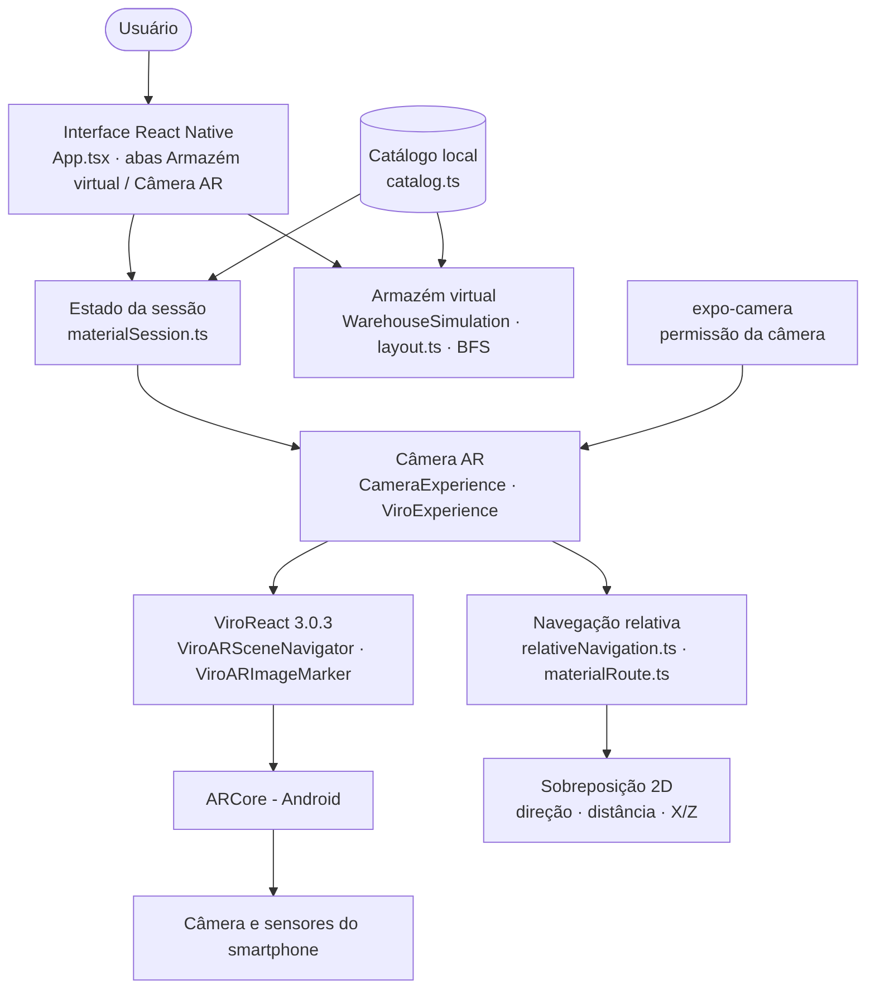
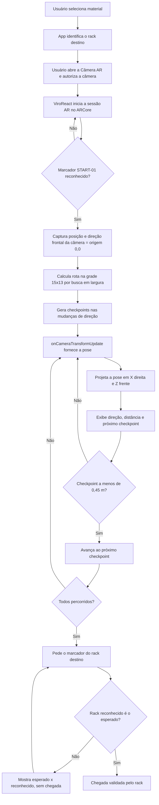

# NexWay

Prova de conceito de localização de materiais em armazém com orientação por Realidade Aumentada em smartphone Android.

## Identificação

| Item | Informação |
|---|---|
| Equipe | NEXUS |
| Curso | Engenharia da Computação |
| Instituição | Centro Universitário Facens — Sorocaba, SP |
| Disciplina | UPX — Realidade Aumentada |
| Professor | Daniel Ohata, conforme o pacote documental fornecido pela equipe |
| Semestre | 2026.2 |

| Integrante | RA | Responsabilidades |
|---|---|---|
| Leonardo Godinho da Silva | 236764 | Catálogo, destinos, rotas, estado da navegação, GitHub/branches e implementação dos Marcos 2 a 5; pesquisa de negócio |
| Rafael de Souza Amorim | 223380 | Base mobile, ambiente React Native/ViroReact, cena AR, reconhecimento de marcadores, build Android e validação física |
| Beatriz Canaveze Fontolan Soares | 235099 | Pesquisa bibliográfica, documentação e artigo científico |
| João Pedro da Silva Ramos | 234911 | Pesquisa bibliográfica, documentação e artigo científico |
| Matheus Nicolas Arizono Ywamoto | 235912 | Pesquisa bibliográfica, documentação, artigo científico e gestão do Trello |
| Matheus Henrique Silva Marcolino | 161109 | Pesquisa bibliográfica, documentação e artigo científico |

A [divisão técnica](NexWay_Divisao_Desenvolvimento_Leonardo_Rafael.pdf) complementa as responsabilidades. A autoria dos marcos identifica commits, sem excluir a colaboração da equipe.

## Visão geral, problema e público-alvo

O NexWay permite selecionar um material de um catálogo local, consultar seu rack na planta e receber direção e distância sobre a câmera. START estabelece a origem e a orientação da navegação; o rack correto confirma a chegada depois dos checkpoints.

Conhecer o código de uma posição não significa saber chegar até ela. A proposta atende operadores pouco familiarizados com o layout e estudantes voluntários na avaliação planejada. A redução de tempo e erros em comparação com uma planta 2D é uma hipótese: o experimento com participantes ainda não foi executado.

## Objetivos

**Objetivo geral:** desenvolver e avaliar uma prova de conceito de orientação visual por RA em smartphone para localizar posições de armazenagem.

Objetivos técnicos implementados:

- buscar material e associá-lo ao rack destino;
- reconhecer START e calibrar a pose da câmera;
- calcular rota por busca em largura, evitando os bloqueios do mapa;
- acompanhar pose X/Z, direção, distância e checkpoints em ordem;
- liberar validação do rack somente depois do último checkpoint;
- registrar chegada uma única vez, sem aceitar rack incorreto;
- verificar tipos e regras por testes automatizados.

A avaliação com participantes e a validação física específica da correção atual permanecem pendentes.

## Funcionalidades atuais

| Identificador | Funcionalidade | Descrição | Status |
|---|---|---|---|
| RF01 | Buscar e selecionar material | Catálogo local com três materiais; busca por código ou descrição | Implementado |
| RF02 | Identificar destino | Associação com RACK-A, RACK-B ou RACK-C | Implementado |
| RF03 | Consultar planta | Mostra layout e rack destino | Implementado |
| RF04 | Simular percurso | Animação na planta, independente da câmera | Implementado |
| RF05 | Reconhecer START | START-01 estabelece origem e direção | Implementado |
| RF06 | Navegar por checkpoints | Grade 15 × 13; avanço sequencial dentro da tolerância | Implementado e testado |
| RF07 | Orientação relativa | Sobreposição 2D com direção, distância e X/Z | Implementado |
| RF08 | Validar chegada | Rack correto somente após todos os checkpoints; registro único | Corrigido e testado; validação física específica pendente |
| RF09 | Rejeitar rack incorreto | Exibe esperado e reconhecido, sem chegada | Testado; validação física específica pendente |
| RF10 | Suspender e recalibrar | Tracking limitado, pose inválida ou salto reiniciam a navegação | Testado; validação física específica pendente |
| RF11 | Destacar setor e prateleira na câmera | Indicação dentro do rack | Planejado |
| RF12 | Orientação 3D | Seta ou mapa 3D | Planejado |

## Tecnologias e arquitetura

| Tecnologia | Versão no projeto | Uso |
|---|---|---|
| React Native / React | 0.86.3 / 19.2.3 | Aplicativo e interface |
| TypeScript | ~6.0.3 | Tipagem |
| Expo | ~57.0.31 | Ferramentas e geração de projetos nativos |
| ViroReact | 3.0.3 | Cena AR, marcadores e pose |
| expo-camera | ~57.0.6 | Permissão da câmera |
| expo-dev-client | ~57.0.20 | Development Build |
| Node.js | 22; mínimo 22.13.0 | Ambiente de desenvolvimento |
| tsx | ^4.20.0 | Execução dos testes |
| ARCore | Integrado pelo ViroReact | Rastreamento em Android |

Dependências em [package.json](package.json), com versões resolvidas no [package-lock.json](package-lock.json).



A interface compartilha a sessão em App.tsx. O reducer da sessão mantém a navegação relativa. A cena ViroReact envia poses e eventos de marcadores; a sessão calcula o progresso pela rota local e decide quando aceitar o rack. Catálogo, mapa e sessão ficam no aplicativo; não há backend nem banco de dados.

## Estrutura do repositório

```text
Nexway/
├── App.tsx
├── index.ts
├── src/                      ar, camera, components, data, navigation, screens, warehouse
├── assets/markers/
├── tests/helpers/
├── scripts/
├── docs/
│   ├── diagrams/             quatro diagramas em MMD, SVG e PNG
│   ├── images/               oito capturas históricas
│   ├── documents/            artigo V5 e índice
│   ├── BUILD_EVIDENCE.md
│   ├── START-AR.md
│   ├── DEVELOPMENT.md
│   └── REVISAO_MERGE.md
├── README.md
├── CHANGELOG.md
├── .gitignore
├── .github/
├── package.json
├── package-lock.json
├── app.json
├── eas.json
├── .easignore
├── .nvmrc
├── tsconfig.json
└── NexWay_Divisao_Desenvolvimento_Leonardo_Rafael.pdf
```

src contém código organizado por responsabilidade; assets contém recursos usados pelo app; docs/images contém capturas documentais. android e ios são gerados pelo Expo e ignorados no Git.

## Como instalar e testar

Instale Git e Node 22. Para compilação local Android, configure Android Studio, SDK, ADB e JDK compatível com o projeto gerado. Use smartphone Android compatível com ARCore e depuração USB habilitada.

```powershell
git clone https://github.com/RafaAmorim-stack/Nexway.git
cd Nexway
git switch docs/organizacao-disciplina
npm ci
npm run typecheck
npm test
```

O commit funcional `7acefc534bc52615189aa3b9bb4f6e8ae9160ad8` exige todos os checkpoints antes da validação do rack. Nesta revisão documental, typecheck passou e os **29/29 testes** passaram. A cobertura inclui chegada antecipada, chegada após o percurso, rack incorreto, ordem dos checkpoints e registro único.

`npm run verify` reúne tipos e testes. `npm run export:web`, `npm run export:ios` e `npm run export:android` verificam bundles; não equivalem a APK/IPA nem a teste físico.

## Android Development Build e como executar

O NexWay não roda no Expo Go: ViroReact exige módulos nativos próprios.

Para gerar localmente no Windows e instalar no aparelho conectado:

```powershell
npx expo prebuild --platform android
cd android
.\gradlew.bat assembleDebug
cd ..
adb devices
adb install -r "android/app/build/outputs/apk/debug/app-debug.apk"
npm start
```

`npm start` inicia o Metro com --dev-client. Abra o NexWay instalado e conecte ao Metro na mesma rede; use `npm run start:tunnel` se necessário. Alterações em módulos nativos ou plugins exigem novo build. A prévia `npm run web` não executa a câmera AR nativa.

Alternativa pelo perfil development de [eas.json](eas.json), com developmentClient habilitado, distribuição interna e APK Android:

```powershell
npx eas-cli@latest login
npx eas-cli@latest init
npm run build:android
```

No init, vincule a conta/projeto Expo da equipe e revise as alterações de configuração. Instale o APK disponibilizado pelo EAS e execute `npm start`. Não versione credenciais. O perfil também prevê iOS, mas não há validação em iPhone.

## Marcadores e utilização

Imprima [assets/markers/print.html](assets/markers/print.html) em tamanho real. Cada marcador deve medir **20 × 20 cm**; confirme com régua. São imagens de tracking, não QR codes.

1. Selecione o material em Armazém virtual e confira o rack destino.
2. Abra Câmera AR e autorize a câmera.
3. Reconheça START-01 no ponto demarcado, olhando para o corredor principal. A pose da câmera define origem e frente do mapa.
4. Percorra os checkpoints em ordem. A escala de teste é 1 m/célula, com tolerância de 0,45 m.
5. Após o último checkpoint, reconheça o rack destino. Antes disso, o rack correto não registra chegada; rack incorreto também não conclui.
6. A chegada é registrada uma única vez. Troca de material, saída da câmera ou perda de navegação exigem nova calibração e percurso.



## Rastreabilidade do Development Build

O APK é um **Development Build**: o código JS/TS executado é servido pelo **Metro**. O SHA-256 verifica a integridade do APK nativo, mas **não identifica sozinho qual JavaScript foi executado**. Alterações JS/TS podem manter o mesmo hash do APK.

[BUILD_EVIDENCE.md](docs/BUILD_EVIDENCE.md) permanece como registro histórico da equipe para f2e1c8f64edbc95b048caf2964bd6e298f33444a, com 24 testes e hash do APK. Não estende automaticamente sua validação física à correção 7acefc534bc52615189aa3b9bb4f6e8ae9160ad8. A demonstração de 25/10/2026 não teve o build exato registrado.

A rastreabilidade funcional deve associar no mesmo registro:

- commit Git e working tree limpa, comprovada por `git status --porcelain` vazio antes do teste;
- resultados dos testes e typecheck dessa versão;
- comando e resultado do build, instalação e SHA-256 do APK;
- Metro iniciado a partir dessa mesma working tree, com commit e terminal registrados;
- aparelho, versão Android e validação física dos cenários da versão corrigida.

Nesta revisão foram executados tipos e testes; não houve nova execução Metro, instalação ou validação física. O relato histórico da equipe não comprova por si só essa associação completa para a versão atual.

## Limitações atuais

- Catálogo fictício de três materiais e mapa fixo 15 × 13; escala e tolerância precisam de ajuste ao espaço real.
- Pose sujeita a deriva, dependente de alinhamento no START, iluminação e marcadores.
- A rota evita apenas bloqueios cadastrados; não detecta obstáculos novos.
- Sobreposição 2D, sem seta 3D, GPS indoor, VPS ou Cloud Anchors.
- Sem destaque de setor/prateleira na câmera, confirmação de retirada ou exportação de métricas na interface atual. Regras legadas não significam funções disponíveis.
- Demonstrações históricas em Xiaomi e ambiente doméstico, sem aferição de precisão, teste em iPhone ou experimento com participantes.
- A correção de checkpoints tem cobertura automatizada; falta registrar validação física específica com a cadeia de rastreabilidade acima.

## Documentação adicional

- [Desenvolvimento](docs/DEVELOPMENT.md) e [revisão documental](docs/REVISAO_MERGE.md).
- [Roteiro histórico START-AR](docs/START-AR.md), a usar junto das condições atuais deste README.
- [Diagramas](docs/diagrams/): arquitetura, caso de uso, navegação e fluxo RA em MMD, SVG e PNG.
- [Capturas](docs/images/): oito imagens de 25/10/2026; não comprovam a correção posterior.
- [Artigo acadêmico V5](docs/documents/NexWay_Artigo_Final_V5.docx) e [índice documental](docs/documents/LEIA-ME.txt), com nota sobre seu recorte histórico.
- [Histórico de alterações](CHANGELOG.md).

Projeto acadêmico educacional. Não há licença de software formal declarada.
